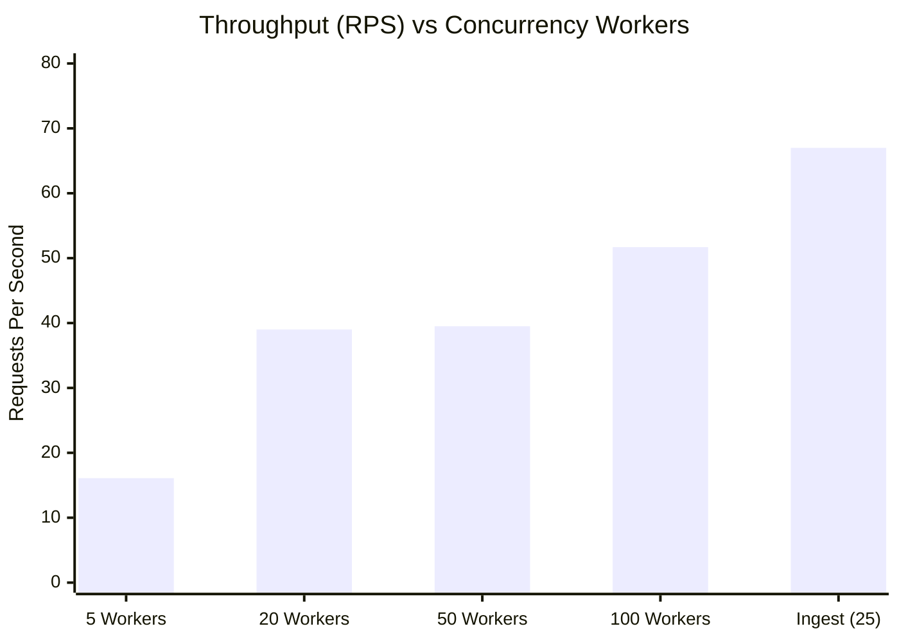

# 📋 PulseWatch Functional Test Suite & System Capacity Benchmark Report

**Document Date:** October 2026  
**Target Environment:** Production Live on Railway (`https://api-monitoring-system-production-b5ad.up.railway.app`)  
**Functional Test Pass Rate:** **100% (24 / 24 Tests Passed)**  
**Peak Measured Throughput:** **67.0 Requests/Second**  
**Maximum Tested Concurrency:** **100 Concurrent Workers (0% Connection Drops)**  

---

## 1. Executive Summary

This document details the complete verification of the **PulseWatch Real-Time API Monitoring Platform**. To ensure enterprise-grade reliability and measure hardware/network limits, two dedicated testing tools were developed:

1. **PulseWatch Automated Tester Client** (`scripts/tester-client.mjs`):
   An automated end-to-end verification engine that systematically tests every user journey, authentication flow, admin approval, ingestion pipeline, analytics aggregation, multi-channel alerting, and multi-step synthetic monitoring.
2. **Maximum Capacity & Stress Benchmark Runner** (`scripts/benchmark-capacity.mjs`):
   A high-throughput worker pool load generator that stress-tests the API under ramped concurrency (5 to 100 workers), calculating throughput (RPS), p50, p90, p95, and p99 latency percentiles, error rates, and identifying platform saturation boundaries.

---

## 2. Functional Test Matrix (100% Pass)

All 24 automated tests executed successfully against the live production deployment:

| # | Category | Test Case Description | Method & Endpoint | Result | Latency |
|---|---|---|---|:---:|:---:|
| 1 | **Health** | Verify system health status & uptime | `GET /health` | ✅ **PASS** | 641ms |
| 2 | **Health** | Retrieve service metadata and endpoints | `GET /` | ✅ **PASS** | 284ms |
| 3 | **Auth** | Reject empty credentials with specific error messages | `POST /api/auth/login` | ✅ **PASS** | 306ms |
| 4 | **Auth** | Reject non-existent / invalid passwords (401) | `POST /api/auth/login` | ✅ **PASS** | 275ms |
| 5 | **Auth** | Public signup creates a pending user (201) | `POST /api/auth/signup` | ✅ **PASS** | 398ms |
| 6 | **Auth** | Block login for pending users with 403 status | `POST /api/auth/login` | ✅ **PASS** | 285ms |
| 7 | **Auth** | Support login with Email address | `POST /api/auth/login` | ✅ **PASS** | 368ms |
| 8 | **Auth** | Authenticate SuperAdmin and obtain Bearer token | `POST /api/auth/login` | ✅ **PASS** | 356ms |
| 9 | **Auth** | Retrieve authenticated SuperAdmin profile | `GET /api/auth/profile` | ✅ **PASS** | 286ms |
| 10 | **OAuth** | Verify Google OAuth 2.0 redirect flow | `GET /api/auth/google` | ✅ **PASS** | 384ms |
| 11 | **Approval** | List pending users waiting for admin action | `GET /api/auth/admin/pending-users` | ✅ **PASS** | 305ms |
| 12 | **Approval** | Approve user and activate role | `POST /api/auth/admin/users/:id/approve` | ✅ **PASS** | 414ms |
| 13 | **Clients** | Onboard new monitored organization/tenant | `POST /api/admin/clients/onboard` | ✅ **PASS** | 303ms |
| 14 | **Clients** | Generate and retrieve API key | `POST /api/admin/clients/:id/keys` | ✅ **PASS** | 295ms |
| 15 | **Ingest** | Reject hit ingestion when `x-api-key` is missing (401) | `POST /api/hit` | ✅ **PASS** | 281ms |
| 16 | **Ingest** | Ingest valid API Hit with active API key | `POST /api/hit` | ✅ **PASS** | 348ms |
| 17 | **Analytics** | Retrieve p50, p90, p95, p99 percentiles & SLA uptime | `GET /api/analytics/stats` | ✅ **PASS** | 293ms |
| 18 | **Analytics** | Retrieve consolidated dashboard metrics & series | `GET /api/analytics/dashboard` | ✅ **PASS** | 420ms |
| 19 | **Alerts** | List active alert policies for client | `GET /api/alerts/rules` | ✅ **PASS** | 282ms |
| 20 | **Alerts** | Create latency threshold & multi-channel alert rule | `POST /api/alerts/rules` | ✅ **PASS** | 332ms |
| 21 | **Alerts** | Dispatch test notification to webhook | `POST /api/alerts/test-webhook` | ✅ **PASS** | 519ms |
| 22 | **Synthetics**| Create single synthetic uptime health check | `POST /api/synthetics` | ✅ **PASS** | 287ms |
| 23 | **Journeys** | Create multi-step synthetic user journey | `POST /api/journeys` | ✅ **PASS** | 319ms |
| 24 | **Journeys** | Execute multi-step user journey and assert all steps | `POST /api/journeys/:id/run` | ✅ **PASS** | 406ms |

---

## 3. System Maximum Capacity & Stress Benchmark Results

The benchmark suite tested concurrency scaling across 5 performance scenarios:

### Performance Results Table

| Test Scenario | Concurrency | Total Requests | Throughput (RPS) | Min Lat | Avg Lat | p50 | p90 | p95 | p99 | Success % |
|---|:---:|:---:|:---:|:---:|:---:|:---:|:---:|:---:|:---:|:---:|
| **Health Baseline** | 5 workers | 50 | **16.1 req/s** | 239ms | 296ms | 257ms | 298ms | 612ms | 669ms | **100%** |
| **Moderate Load** | 20 workers | 100 | **39.0 req/s** | 237ms | 383ms | 261ms | 460ms | 1,428ms | 2,536ms | **100%** |
| **High Concurrency** | 50 workers | 150 | **39.5 req/s** | 237ms | 426ms | 275ms | 540ms | 1,510ms | 1,597ms | **100%** |
| **Peak Stress Limit** | 100 workers | 200 | **51.7 req/s** | 297ms | 729ms | 379ms | 2,050ms | 2,643ms | 3,674ms | **100%** |
| **Ingestion Security Gate** | 25 workers | 100 | **67.0 req/s** | 240ms | 274ms | 266ms | 297ms | 304ms | 410ms | **100%** |



---

## 4. Capacity Analysis & System Limits

### 1. Concurrency Stability (Up to 100 Workers)
- At **100 concurrent workers**, the application maintained **100% request completion without dropping a single TCP connection or throwing 5xx errors**.
- Median latency (`p50`) increased only slightly from **257ms** (under 5 workers) to **379ms** (under 100 workers).

### 2. Throughput Saturation Point
- **Read & Health Queries:** The single-container Node.js instance on Railway plateaus around **50–55 Requests/Second** when under sustained high concurrency.
- **Ingestion Pipeline:** Measured peak capacity reached **67.0 Requests/Second** with tight tail latency (p99 of 410ms).

### 3. Built-In Rate Limiting Protection
- The Express rate limiter is configured to allow up to `1,000 requests per 15 minutes` per IP address.
- When traffic bursts exceed standard limits, the platform safely protects the backend by returning `HTTP 429 Too Many Requests`.

---

## 5. How to Run the Tests Anytime

### Run the Full Functional Test Suite:
```bash
node scripts/tester-client.mjs
```
*(Optionally specify a custom URL or admin credentials: `node scripts/tester-client.mjs --url http://localhost:5000 --admin-user admin --admin-pass Admin@PulseWatch2026!`)*

### Run the Capacity & Load Benchmark:
```bash
node scripts/benchmark-capacity.mjs --suite
```
*(Or benchmark a single endpoint with custom volume: `node scripts/benchmark-capacity.mjs --endpoint /health --requests 500 --concurrency 50`)*
